# FairMatch Bangalore

**An agentic AI system that matches Bangalore engineering students to real internships, compares allocation policies for fairness, and explains every decision.**

UN Sustainable Development Goals: **SDG 8** (decent work) · **SDG 10** (reduced inequality) · **SDG 16** (transparent, accountable institutions).

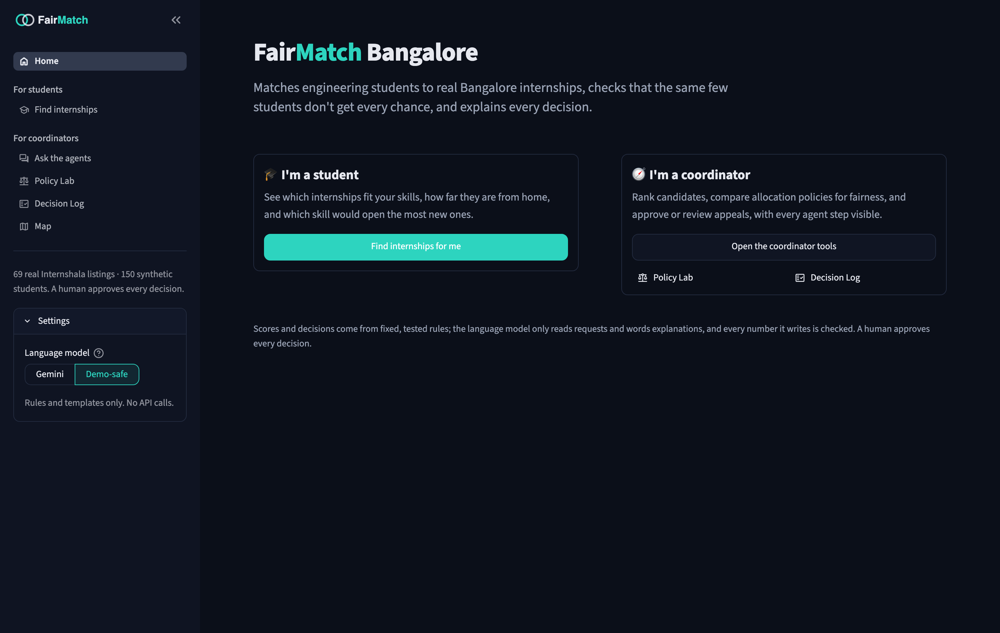

This README is written for a student learning agentic AI. It explains *what* the system does, *how* the agents work together, and, most importantly, *why the LLM is never allowed to make a decision*.

---

## 1. The problem

India has a large **education-to-employment gap**: youth unemployment is far higher than overall unemployment, and a major cause is skill mismatch. In a city like Bangalore, internships and project slots are handed out with incomplete information, which causes three problems:

| Problem | What it looks like | SDG |
|---|---|---|
| **Mismatch** | Students never find opportunities that fit their skills. | 8 |
| **Concentration** | The same well-connected students get selected again and again while others get nothing. | 10 |
| **Opacity** | Nobody can explain or contest *why* someone was chosen. | 16 |

FairMatch is a **decision-support tool** for whoever allocates opportunities to many people (placement cells, internship schemes, hackathon organisers). It proposes, measures and explains. **A human always approves the final decision.**

## 2. What you can do in the app

The app opens on a **Home** page with two paths: *I'm a student* and *I'm a coordinator*. The navigation is grouped the same way.

| Page | For | What it shows | SDG |
|---|---|---|---|
| **Find internships** | Students | Pick your skills (or a student), interests and home area. You get your top 5 real listings with a per-skill breakdown and the commute, plus the skills that would make you eligible for the most extra listings *in your interests* ("also opens" lists the rest). | 8 |
| **Ask the agents** | Coordinators | Chat with the agents. The results tables appear as soon as they're ready, and the checked explanation follows. On the right, each agent reports in one plain sentence; *Developer details* shows every tool call. | 8 |
| **Policy Lab** | Coordinators | All listings allocated under 3 policies (optionally with a commute limit), compared on skill fit, Gini, students reached, repeat selection, average commute and the outskirts selection gap. Then a 4-round simulation. | 10 |
| **Decision Log** | Coordinators | Every proposal with its reasons, including anyone skipped and why. Approve it, or appeal it and watch the Auditor re-evaluate. | 16 |
| **Map** | Coordinators | Listings pinned across Bangalore, coloured by domain, with students' home areas as a heat layer. | 8 · 10 |

(The SDG column is for this README; the app itself just describes what each page does.)

| | |
|---|---|
| 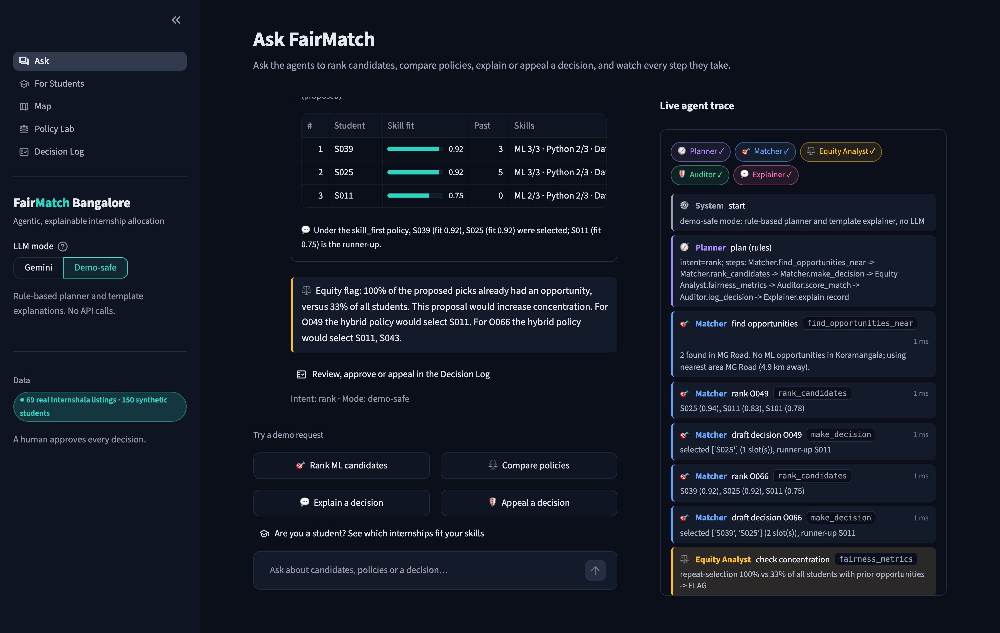 | 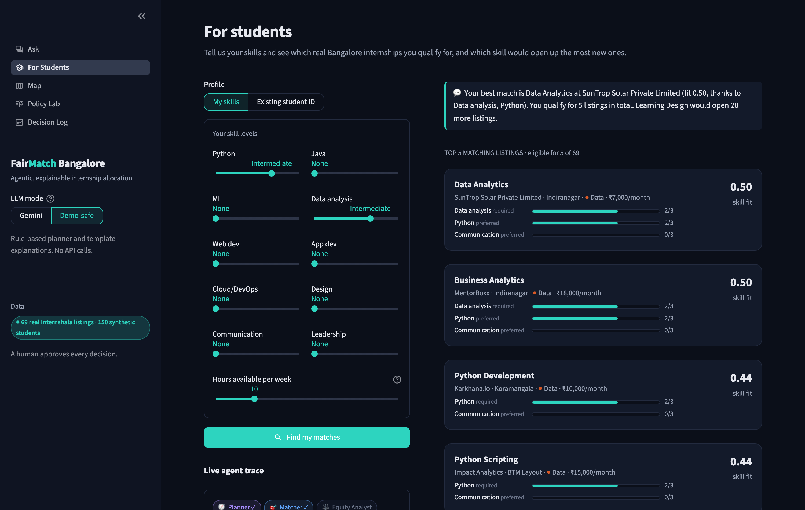 |
| 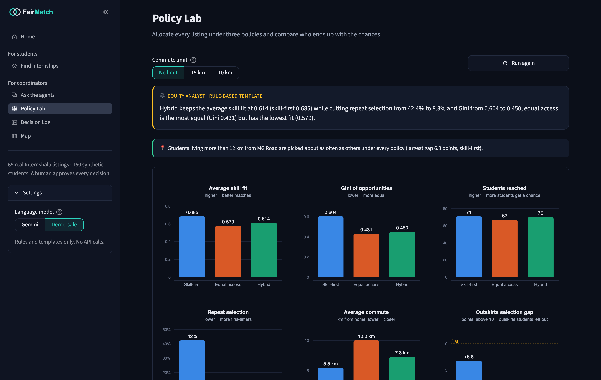 | 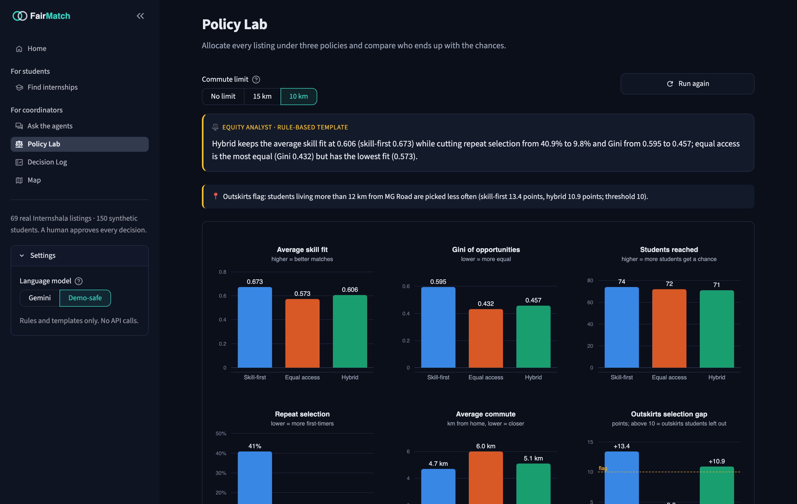 |
| 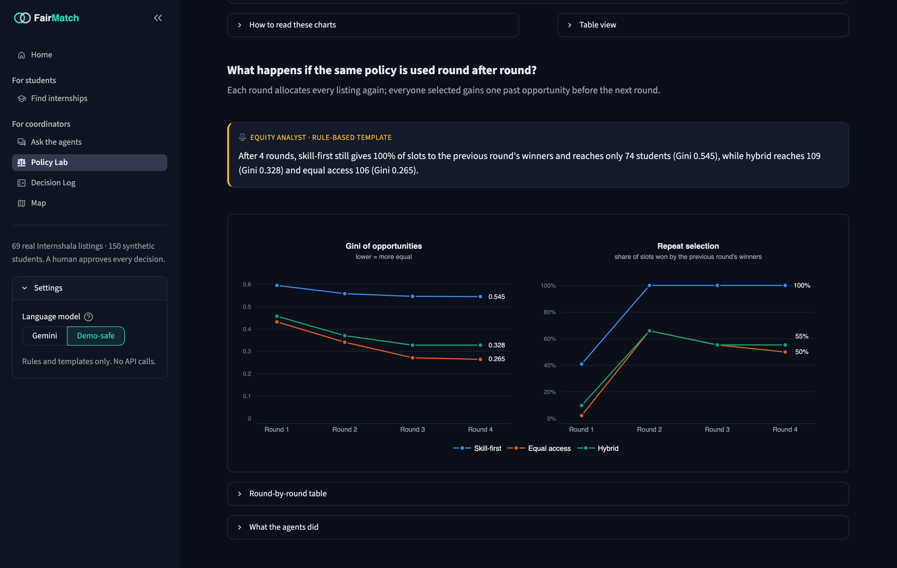 | 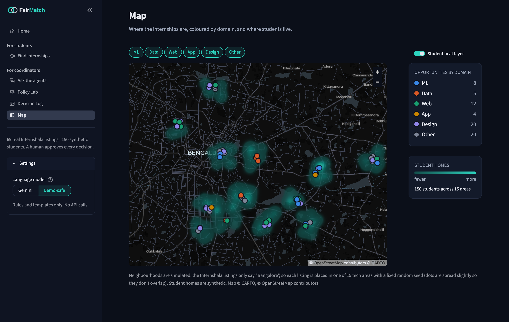 |
| 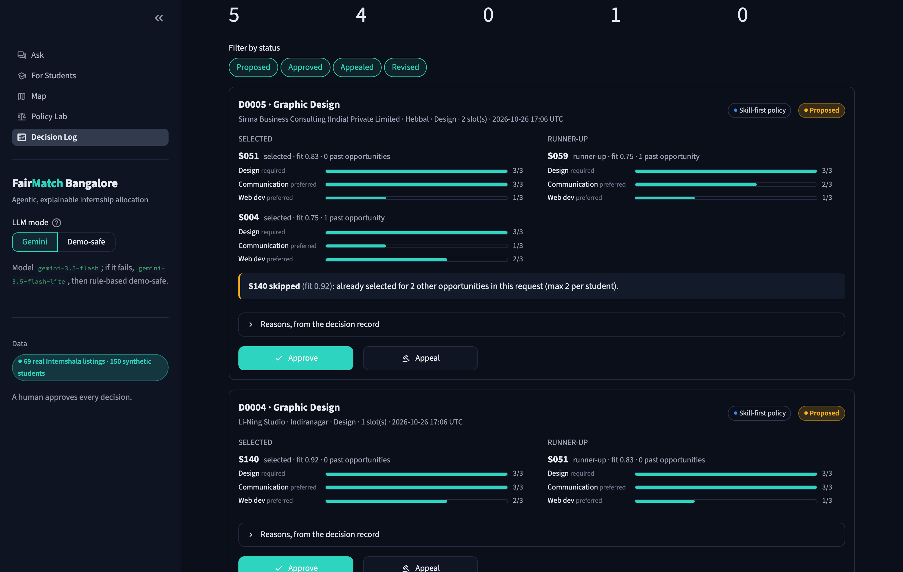 | 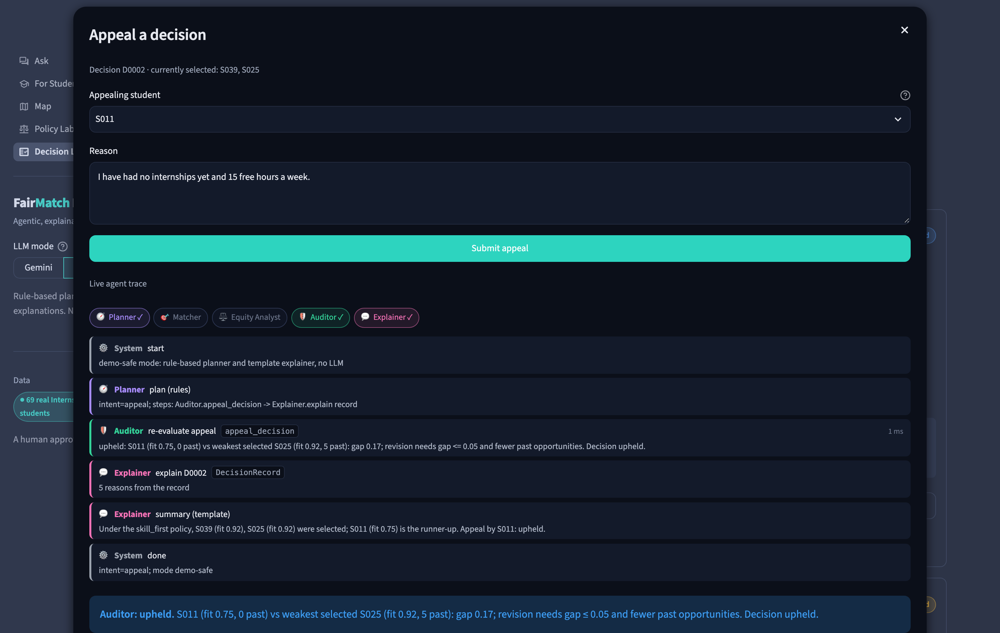 |

The UI pass (a critique of every page, what was removed, and the light motion) is written up in [`docs/ui-critique.md`](docs/ui-critique.md).

## 3. Architecture

The key design idea is a strict split. **Deterministic tools** make every decision, and **agents** decide *which* tools to call and in *what order*. The LLM sits at the edges: it reads the request and rephrases tool output, and both of those are checked.

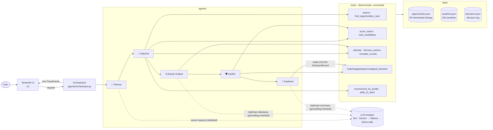

### Folder map

```
data_pipeline/   load_kaggle.py, generate_students.py, import_form.py, build.py, schemas.py
tools/           search, scoring, allocation, fairness, decisions, recommend, simulation  (no LLM, unit-tested)
agents/          planner, matcher, equity, auditor, explainer, orchestrator, trace, grounding, cli
llm/             client.py: Gemini / Ollama / demo-safe wrapper (standard library only)
ui/              app.py + views/ (home, students, ask, policy_lab, decision_log, map) + common.py
tests/           125 unit tests (pytest)
docs/            screenshots/ and ui-critique.md
```

## 4. How the agents work together

Each request becomes a **plan** with one of six intents. The steps for each intent are fixed in code (`agents/planner.py`). The LLM can choose the intent and the parameters, but it can't invent new steps. If a request matches none of them, the plan is **help**: the Planner lists what it can do instead of guessing. (It used to default to ranking, so *"I know python and sql, what can I do?"* ranked candidates for three random listings.)

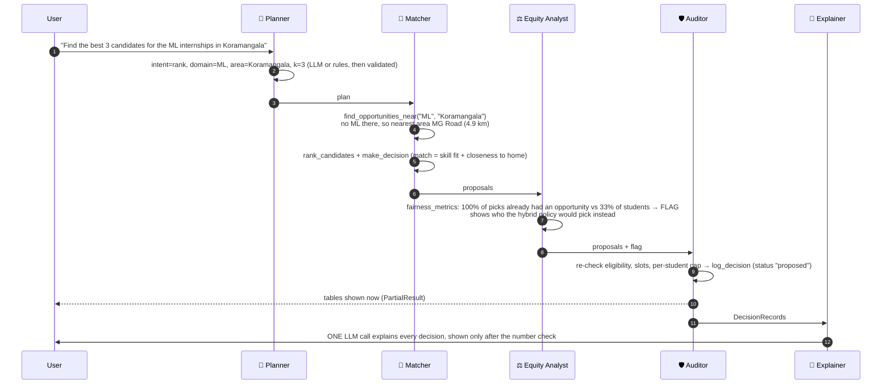

| Agent | Job | Tools it calls | Uses the LLM? |
|---|---|---|---|
| 🧭 **Planner** | Turn the request into a plan (intent + parameters). | none | Optional: fills a JSON form; every field is validated. |
| 🎯 **Matcher** | Score, rank, allocate, simulate and recommend. | `find_opportunities_near`, `rank_candidates`, `make_decision`, `allocate`, `simulate_rounds`, `recommend_for_profile`, `skills_to_learn` | Never |
| ⚖️ **Equity Analyst** | Detect concentration and compare policies. | `fairness_metrics`, `make_decision` | Optional: rewords the takeaway; numbers are checked. |
| 🛡️ **Auditor** | Enforce the rules, log decisions, handle appeals. | `score_match`, `log_decision`, `get_decision`, `appeal_decision` | Never |
| 💬 **Explainer** | Explain a decision from its record only, or a student's matches from the tool results only. | reads the `DecisionRecord` / tool output | Optional: rewords the summary; numbers are checked. |

**The intents**

| Intent | Example | Agents |
|---|---|---|
| rank | *Find the best 3 candidates for the ML internships in Koramangala* | all five |
| compare | *Compare the allocation policies* | all five (includes the 4-round simulation) |
| recommend | *I know python and sql, what can I do?* (or the For Students form) | Planner → Matcher → Explainer |
| explain | *Explain the most recent decision* | Planner → Auditor → Explainer |
| appeal | *Appeal D0002 for S011: I have had no internships yet* | Planner → Auditor → Explainer |
| help | *What's the weather like?* | Planner only: lists what it can do |

The For Students form is already structured, so it hands the Planner a ready profile (`plan (form)` in the trace). No parsing or LLM call is needed for that step.

**The live trace.** Every step emits `{agent, action, tool, args, result_summary, duration_ms, kind}`. When an agent finishes, it also writes **one plain-language headline**, e.g. *"Matcher ranked the eligible students (72, 42) for 2 ML listings in MG Road…"*. The UI shows only these headlines by default. The *Developer details* toggle (or `--verbose` on the CLI) shows every tool call, timing and raw LLM output. Text is never cut off mid-word.

The orchestrator offers the trace two ways: an `on_event` callback, and a `stream()` generator. The generator also yields a `StepStarted` when a step *begins* (so the UI can show "Matcher is working…") and a `PartialResult` as soon as the tables exist. That lets the UI draw results before the Explainer has written anything.

**One Explainer call per request.** The Explainer explains *all* decisions in a single LLM call (`{decision_id: summary}`), and checks each summary separately. A rank request uses 2 LLM calls in total (Planner and Explainer) instead of 3 or more, which cut a typical Gemini request from about 15 s to about 8 s. Explanations are revealed only **after** they pass the number check, so nothing unverified is ever on screen.

**Fallback.** In Gemini mode the wrapper tries `gemini-3.5-flash`, then `gemini-3.5-flash-lite` (each model has its own free-tier quota), then a local Ollama model. A model that hits its quota is not called again for the rest of the run. If everything fails, the run switches to **demo-safe** mode and continues with the keyword planner and template text. The trace shows a friendly line ("Gemini quota reached, continuing rule-based") and keeps the raw API error under *Technical details*. Scores, rankings and decisions are identical in every mode, because the LLM never produced them.

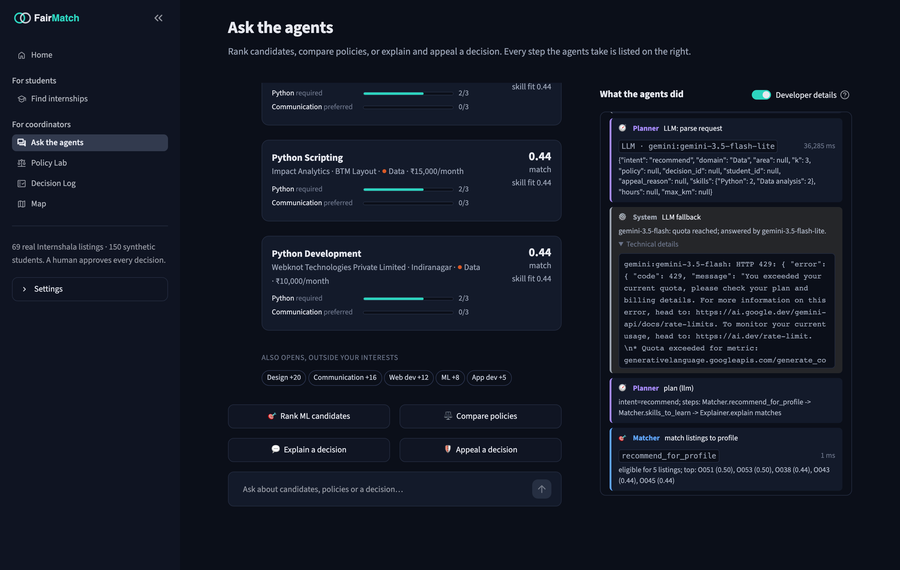

## 5. The three allocation policies

**Match score.** Skill fit is transparent on purpose. Required skills are worth 2 points and preferred skills 1 point; a student earns `level/3` of each, and skill fit = points earned ÷ points possible. The **match score** then blends in how close the listing is to home:

`match = (1 − w) × skill fit + w × closeness`, where `closeness = 1 − commute_km / 25` and `commute_km` is the straight-line (haversine) distance from home to the listing.

A student is eligible with at least half the required skills and at least 8 hours a week. Optionally, a request can also set a commute limit ("within 10 km").

| Policy | Commute weight `w` | Rule | Trade-off |
|---|---|---|---|
| `skill_first` | 0.2 | Best match score wins. | Highest fit, but chances concentrate on students with strong (often already-polished) profiles. |
| `equal_access` | 0 | Fewest past opportunities first; skill fit only breaks ties. | Most equal, lowest fit. |
| `hybrid` | 0.1 | match score ÷ (1 + 0.5 × past opportunities) | Keeps most of the fit while sharply cutting repeat selection. |

**Why the commute weight differs per policy.** Shorter commutes make an internship more practical, but penalising distance pushes out students who live on the city's outskirts, which is itself an equity issue. So each policy sets its own weight. The Equity Analyst also measures the **outskirts selection gap**: how many percentage points less often students living more than 12 km from MG Road are selected than everyone else. It flags any gap above 10 points.

On the real data:

| | Skill fit | Gini | Repeat selection | Avg commute | Outskirts gap |
|---|---|---|---|---|---|
| Skill-first | 0.685 | 0.604 | 42.4% | 5.5 km | 6.8 pts |
| Equal access | 0.579 | 0.431 | 0% | 10.0 km | −0.6 pts |
| Hybrid | 0.614 | 0.450 | 8.3% | 7.3 km | 1.9 pts |

With a **10 km commute limit**, the outskirts gap rises to **13.4 points for skill-first** and **10.9 for hybrid**, and both are flagged. Equal access stays at 3.6. That's the trade-off made visible.

**Rules shared by every policy**
- **Ties** go to the student with *fewer* past opportunities, then the lower id. (Earlier, ties broke by id alone, so S010 with 5 past opportunities beat S140 with 0 at an identical fit.)
- **At most 2 opportunities per student per request/round.** If the best candidate is already at the cap, they are **skipped**, the next candidate takes the slot, and the record says so: *"Harsh M. (S140) skipped: match 0.84 (skill fit 0.92, commute 11.8 km), but already selected for 2 other opportunities in this request (max 2 per student)."* (Earlier the Auditor removed such a student silently and nobody was promoted, which produced a decision with "Selected: Nobody" next to a perfect runner-up.)
- **Appeals.** An appeal wins if the appellant's match score is within 0.05 of the weakest selected student's **and** they've had fewer past opportunities. The displaced student becomes the runner-up.

### What happens over time (multi-round simulation)

`tools/simulation.py` runs the same policy for 4 rounds; everyone selected in a round gains +1 past opportunity before the next round.

| After 4 rounds | Gini | Slots won by the previous round's winners | Students reached at least once |
|---|---|---|---|
| Skill-first | 0.555 | **100%** | 71 |
| Equal access | 0.255 | 44% | 104 |
| Hybrid | 0.329 | 51% | 109 |

Skill-first locks in the same ~70 students every round; hybrid reaches 38 more people. "Repeat selection" here means *won the previous round too* (round 1: had any real past opportunity). The usual definition, *ever had an opportunity*, hits 100% for every policy after one or two rounds, because 132 slots go to 150 students, so it would hide the difference.

## 6. Why the LLM never decides

> All decisions come from deterministic tools. **The LLM never invents a score or a reason.** (PLAN.md)

That's easy to write and surprisingly easy to break. Here's what happened while this project was being built.

**Example 1: a true-sounding false reason (Phase 2).** The Explainer was given the full decision record and asked to summarise it. Gemini wrote:

> *"S025 was selected because they had higher ML skill ratings … and **5 past opportunities** compared to S011's 0."*

Every number in that sentence is real. The **reasoning is false**: under `skill_first`, past opportunities play *no role*. An explanation like this would tell a student that having had chances before *helps* you get more, which is the exact unfairness the system exists to expose.

**Example 2: an invented id (Phase 3).** Asked to *"Explain the most recent decision"*, the Planner LLM filled in `decision_id: "D0001"`. That id appeared nowhere in the request (the latest decision was D0002). The id was well-formed, so a check of its format alone would have explained the wrong decision.

**The defences, in layers:**

1. **Tools decide; the LLM only talks.** Scores, rankings, selections and appeal outcomes come from `tools/`, which are plain functions with unit tests.
2. **Fixed plans.** The LLM picks an intent from a fixed list; the steps for each intent are hard-coded.
3. **Validate every LLM field** (`agents/planner.py`). Values must come from the allowed lists, and ids and skills must appear in the user's request. Anything else is dropped (and shown in the trace as "LLM value ignored"). A request that fits no intent gets a help message, not a guess.
4. **Grounding check** (`agents/grounding.py`). Every number and id in LLM text must appear in the facts the agent supplied, otherwise the text is rejected and a template is used.
5. **Give the LLM the rule, not just the data.** The Explainer now receives the policy's exact rule (*"candidates are ranked purely by skill fit; past opportunities play no role"*) and is told that rule is the only reason anyone was selected. This fixed Example 1, which no number check could catch.
6. **Demo-safe mode.** The whole system works with no LLM at all. Switch it on in the sidebar and compare: the decisions don't change.

The lesson for agentic systems: **put the LLM where being wrong is cheap and checkable, never where being wrong changes an outcome.**

## 7. Data sources and their limits

| Data | Source | Limits |
|---|---|---|
| **Opportunities** | Kaggle *Internshala Dataset* (`aayush9119/internshala-dataset`), filtered to Bangalore: **69 listings** | Listings only say "Bangalore", so **neighbourhoods are simulated** (seeded random choice among 15 tech areas). The scrape's *duration* column holds start dates, so every listing is set to 8 weeks. Most Bangalore listings are sales/HR/marketing; we keep at most 20 per domain so the 8 ML / 5 Data / 12 Web / 4 App listings survive. Skills come from job titles via a fixed keyword map. Slot counts are seeded. |
| **Students** | **Synthetic**, seeded generator (150 students, colleges "A–H", no real people) | **Names are synthetic too.** "Ananya R. (S025)" is a common Indian first name plus a random initial, generated (with its own seed) only to make the UI easier to follow; it is not a real person. History is **deliberately skewed**: about 15% "well-connected" students hold most past opportunities, so the fairness problem is visible. Real students would behave differently. |
| **Google Form** (optional) | Drop a CSV export with "form" in its name into `data/raw/` | Rows without consent are dropped; the form collects no names, phones or emails. |

**Commute distances are illustrative.** Listing neighbourhoods are simulated and student homes are synthetic, and the distance is a straight line, not travel time. The commute and outskirts features show the *mechanism*; they are not real travel data.

If the Kaggle CSV is missing, a bundled synthetic opportunity set is used so the app always runs.

## 8. How to run

```bash
# 1. Setup (once)
python3 -m venv .venv
source .venv/bin/activate
pip install -r requirements.txt

# 2. Data: put the Kaggle CSV (any name containing "internshala") in data/raw/, then:
python -m data_pipeline.build

# 3. Optional: Gemini. Copy .env.example to .env and add your key
#    (free key: https://aistudio.google.com/apikey). Without one, demo-safe mode is used.

# 4. Run the app
streamlit run ui/app.py
```

Other entry points:

```bash
python -m tools.demo                                                # Phase 1: tools only
python -m agents.cli "Find the best 3 candidates for ML internships in Koramangala"
python -m agents.cli --mode demo-safe "Compare the allocation policies"
python -m agents.cli "I know python and sql, what can I do?"
python -m agents.cli --verbose "Compare the allocation policies within 10 km"   # developer view
pytest -q                                                           # 125 tests
```

**About the Gemini free tier.** It allows about **20 requests per model per day**, and one "rank" request uses 3 calls. When `gemini-3.5-flash` runs out, `gemini-3.5-flash-lite` takes over (set `GEMINI_FALLBACK_MODEL` to change it); when both run out, the app continues in demo-safe mode. Rehearse in demo-safe mode to save quota. Google also retires models for new keys from time to time; if you see "model not available", set `GEMINI_MODEL` to a current flash model.

## 9. SDG → feature map

| SDG | Target it speaks to | Feature |
|---|---|---|
| **8: Decent work** | Youth employment, skill matching | Skill-fit scoring and ranking; For Students page (matches + skills to learn next); map of real Bangalore internships |
| **10: Reduced inequality** | Equal opportunity regardless of background | Equity Analyst flags concentration and the outskirts selection gap; Policy Lab compares Gini, repeat selection, reach and commute, once and over 4 rounds; per-policy commute weights; hybrid policy; ties go to students with fewer past opportunities |
| **16: Accountable institutions** | Transparent, accountable decision-making | Decision log with reasons, including who was skipped and why; human approval; appeals re-evaluated by a rule-based Auditor; live trace of every step, with honest error messages; explanations only from the record |

## 10. Non-goals

No authentication, no database (JSON files only), no deployment, no web scraping. FairMatch is a teaching prototype, and real allocation decisions need real data, consent and oversight.

## 11. Screenshots

**Home:** the two starting paths, one for students and one for coordinators.
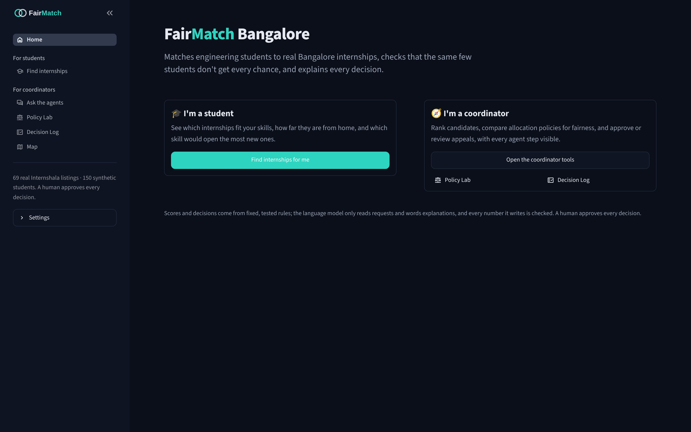

**Find internships:** a student's top matches and the skills that would open up more listings.
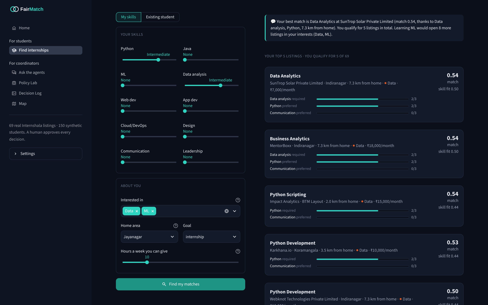

**Ask the agents:** a rank request with each agent's step shown in the trace.
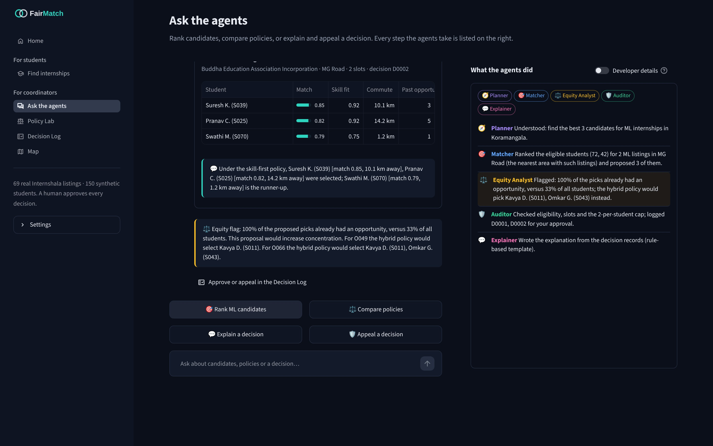

**Policy Lab:** all listings allocated under the three policies, side by side.
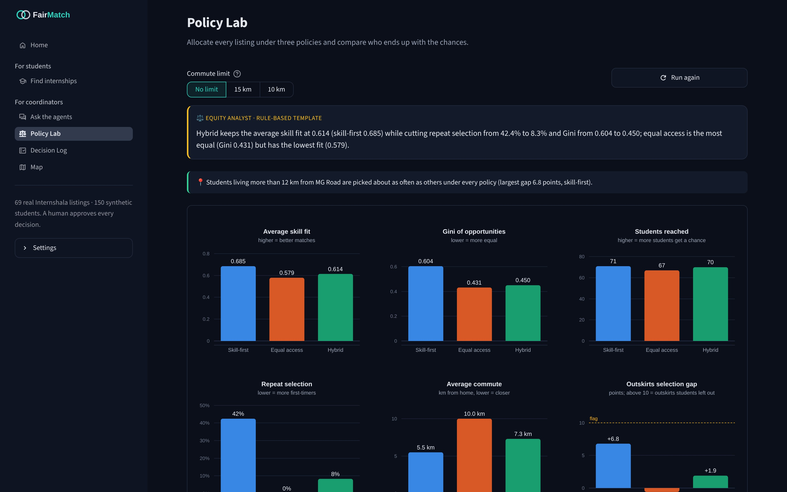

**Policy Lab simulation:** how each policy plays out over four rounds.
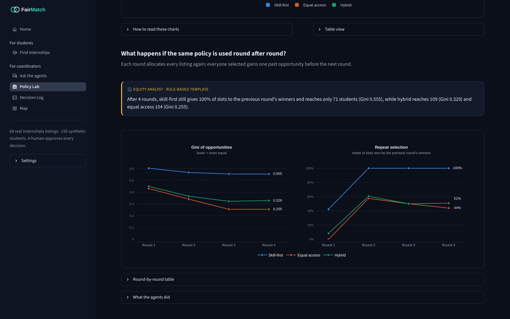

**Decision Log:** an appealed proposal after the Auditor revised it.
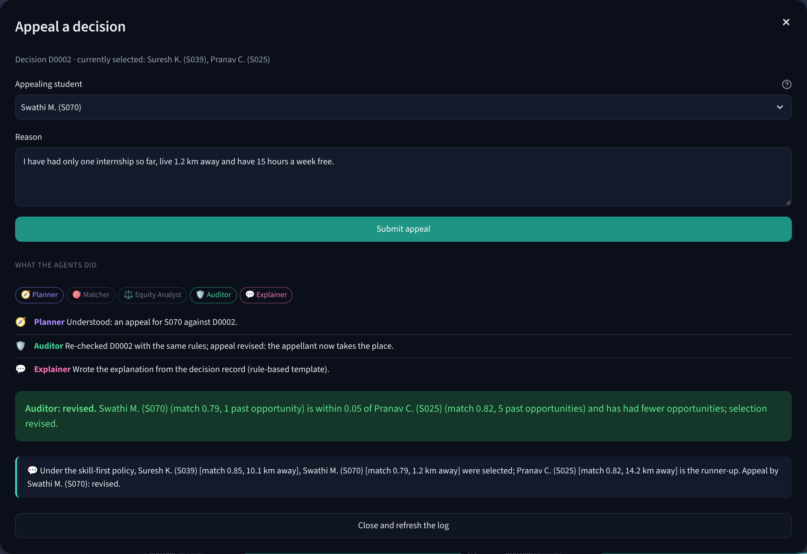
