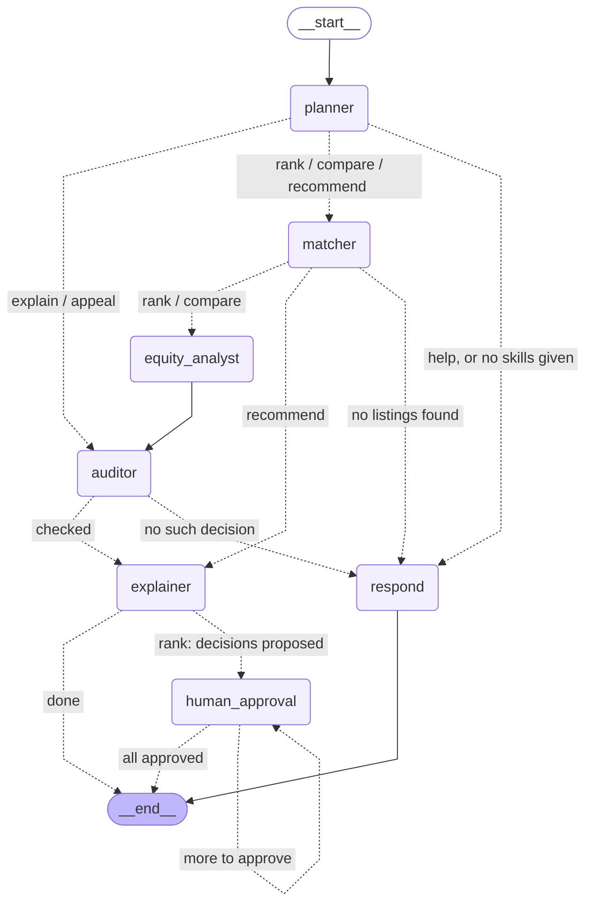

# The FairMatch agent graph (LangGraph)

Generated from the compiled graph by `python -m agents.graph`; do not edit by hand.
Rendered image: [screenshots/langgraph.png](screenshots/langgraph.png).

| Node | Calls (unchanged) |
|---|---|
| `planner` | `agents.planner.plan` (rules, or a checked LLM reading of the request) |
| `matcher` | `agents.matcher.rank` / `compare` / `recommend` |
| `equity_analyst` | `agents.equity.check_proposals` / `compare_policies` |
| `auditor` | `agents.auditor.verify_and_log` / `check_allocations` / `fetch` / `appeal` |
| `explainer` | `agents.explainer.explain_all` / `explain_matches` / `explain` + shared answer formatting |
| `respond` | short answers: the help text, "tell me your skills", "no such decision" |
| `human_approval` | `interrupt()`: pauses until a person presses **Approve**, then `tools.decisions.approve_decision` |

Solid arrows always run; dotted arrows are conditional routes, labelled with the intent
or outcome that takes them. The routes match the fixed steps in `agents/planner.py` (`STEPS`).
